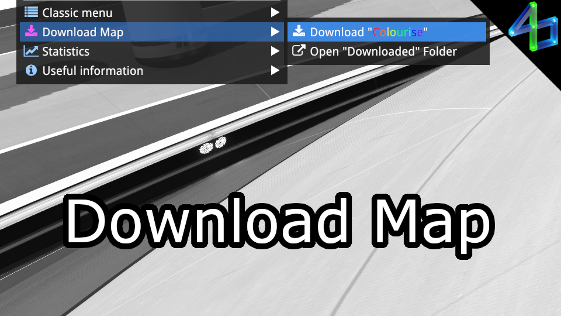

# Download Map

Every time you play a map, the game caches the map file - this plugin simply copies that file to a more convenient location (C:/Users/USERNAME/Documents/Trackmania/Maps/Downloaded) and names it with the map's name.

